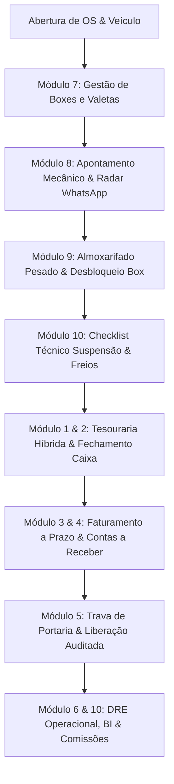

# 🚗 Pátio-CRM & Gestão de Oficina Pesada (v1.0.0)

[](https://github.com/Cunha83/Patio-CRM)
[](docs/operacao/PILOTO_WHATSAPP_FINANCEIRO.md)
[](tests/)
[](https://nodejs.org/)
[](https://sqlite.org/)
[](services/whatsapp/)

**Sistema de Gestão Operacional de Pátio, Chão de Oficina, Almoxarifado Pesado e Tesouraria Híbrida (Web + WhatsApp Bot) para Oficinas Especializadas em Linha Pesada.**

Focado em veículos comerciais e frotistas: **caminhões, carretas, cavalos mecânicos, ônibus e semirreboques**, com especialização em **suspensão pesada, feixes de molas, embuchamento de eixos, freios a ar e alinhamento de chassi**.

> [!NOTE]
> **POSICIONAMENTO E ESCOPO:** O Pátio-CRM é uma plataforma de controle de chão de fábrica, produtividade de boxes, almoxarifado de peças pesadas, tesouraria operacional e relacionamento via WhatsApp. **Não é um emissor/escriturador fiscal nem substitui o ERP contábil**. O sistema foi desenhado para operar integrado via API aos principais ERPs do mercado (Totvs, Omie, Sankhya, ContaAzul, Bling), alimentando a contabilidade oficial com dados consolidados e auditados.

---

## 📑 Sumário Executivo
1. [Proposta de Valor e Diferenciais](#-proposta-de-valor-e-diferenciais)
2. [Arquitetura dos 10 Módulos de Domínio](#-arquitetura-dos-10-módulos-de-domínio)
3. [Operação Híbrida: Web Dashboard & Bot WhatsApp](#-operação-híbrida-web-dashboard--bot-whatsapp)
4. [Segurança, RBAC Granular & Auditoria SQLite](#-segurança-rbac-granular--auditoria-sqlite)
5. [Resiliência, Idempotência & Controle de Concorrência](#-resiliência-idempotência--controle-de-concorrência)
6. [Instalação, Configuração e Inicialização](#-instalação-configuração-e-inicialização)
7. [Bateria de Testes Automatizados](#-bateria-de-testes-automatizados)
8. [Inventário e Documentação Técnica](#-inventário-e-documentação-técnica)

---

## 🌟 Proposta de Valor e Diferenciais

O chão de oficina de linha pesada possui dinâmicas peculiares que softwares convencionais de automóveis não atendem:
- **Espaço Físico Escasso (Boxes/Valetas):** Caminhões ocupam grandes baias; manter um veículo parado por falta de peças gera prejuízo severo e gargalo logístico no pátio.
- **Mecânico no Chão de Fábrica:** O mecânico pesado não senta à frente de um computador. Suas interações (apontamentos de início, pausas, pedidos de peças e laudos) ocorrem pelo WhatsApp diretamente de seu smartphone.
- **Qualidade Crítica em Suspensão e Freios:** Falhas de montagem em grampos de mola ou cuícas de freio causam acidentes graves. O sistema impõe trava de checklist técnico obrigatório antes de autorizar conclusão ou saída.
- **Rastreamento de Garantia por Placa (90 Dias):** O sistema detecta retornos em garantia, vincula à OS de origem e expurga automaticamente o serviço da base comissionável do mecânico.

---

## 🏗️ Arquitetura dos 10 Módulos de Domínio

O Pátio-CRM v1.0.0 foi construído em arquitetura modular de domínio com as seguintes frentes integradas:



### 1. Fluxo de Caixa Híbrido, Rastreabilidade e Estornos Contábeis Auditados
- Registro bidirecional de receitas e despesas com identificação compulsória da origem (`origem: 'whatsapp'` vs `origem: 'web'`).
- Estornos contábeis compensatórios com trava de perfil Dono/Gestor, gerando contra-lançamento auditado sem expurgar o histórico original.

### 2. Fechamento de Caixa por Origem, Sangria, Suprimento e Trava de Imutabilidade
- Apuração cega ou declarada de saldos por forma de pagamento (Dinheiro, Pix, Cartão, Boleto).
- Operações de Sangria (retirada para cofre/banco) e Suprimento (aporte de troco) com rastreamento no WhatsApp e interface web.
- Turno de caixa fechado torna-se imutável, bloqueando lançamentos retroativos.

### 3. Conciliação de Ordens de Serviço (OS), Adiantamentos e Saldo Devedor
- Controle integrado de adiantamentos/sinais de entrada com cálculo automático de saldo remanescente.
- Totalização em tempo real de mão de obra + peças aplicadas.

### 4. Faturamento a Prazo (Contas a Receber), Agenda de Vencimentos e Baixa via Bot
- Faturamento do saldo residual em boletos ou duplicatas a prazo (30, 60, 90 dias).
- Liquidação total ou parcial de títulos financeiros via Web ou comando WhatsApp com comprovante auditado.

### 5. Trava de Portaria / Saída de Pátio e Override Auditado com RBAC
- O porteiro valida a placa na saída: liberação permitida apenas para OSs quitadas, faturadas a prazo ou retornos de garantia.
- Liberação excepcional auditada com obrigatoriedade de perfil superior (`dono`, `tenant_admin`, `platform_admin`) e justificativa no SQLite.

### 6. DRE Operacional Simplificado
- Demonstrativo gerencial com separação nítida entre receitas de serviços (mão de obra), receitas de peças e deduções operacionais.
- Isolamento contábil que não mistura movimentações de tesouraria pura com o resultado operacional das OSs.

### 7. Gestão de Boxes/Valetas com Trava de Colisão Física
- Controle de ocupação física dos boxes (ex.: `BOX-01: Linha Pesada`, `BOX-02: Rampa Pneumática`).
- Trava de concorrência que impede alocação de mais de um veículo no mesmo box físico (`BOX_JA_OCUPADO` / HTTP 409).

### 8. Apontamento de Mecânicos, Pausas por Gargalo e Radar de Pátio via WhatsApp
- Mecânico envia comandos diretos (`iniciar os 101`, `pausar os 101 aguardando peca`, `pronto os 101`).
- Painel radar com status de gargalos operacionais e tempo de permanência em cada etapa.

### 9. Almoxarifado de Peças Pesadas, Requisição na OS e Desbloqueio Automático de Box
- Catálogo de componentes pesados (molas, pinos de centro, buchas de bronze, amortecedores, válvulas de freio).
- Baixa automática no estoque ao requisitar na OS com alerta de estoque mínimo.
- Desbloqueio e retomada da OS ao registrar a chegada da peça em falta (`chegou peca os 101`).

### 10. Checklist Técnico Pesado, Dossiê de Garantia por Placa (90 dias) e BI de Comissões
- Checklist compulsório com itens de segurança crítica (torque de grampos de mola, folga de embuchamento, lonas/pastilhas e cuícas).
- Rastreamento por placa nos 90 dias canônicos (Art. 26 do CDC).
- Apuração de produtividade por mecânico e comissões (alíquota padrão de 20% sobre mão de obra líquida), expurgando rigorosamente serviços em garantia.
- Dashboard BI com cartões executivos e gráficos em barras responsivos para visualização semanal e mensal.

---

## 💬 Operação Híbrida: Web Dashboard & Bot WhatsApp

O Pátio-CRM opera de forma fluida tanto no terminal desktop da recepção e gerência quanto no celular da equipe de campo:

### Principais Comandos via WhatsApp

| Categoria | Comando Exemplo | Ação Executada |
| :--- | :--- | :--- |
| **Financeiro** | `!caixa` | Posição consolidada de saldo, entradas, saídas e títulos do dia |
| **Financeiro** | `!extrato [hoje/semana/mes]` | Extrato contábil detalhado de movimentações |
| **Financeiro** | `!vencimentos` ou `contas a receber` | Títulos a vencer no dia e próximos dias |
| **Financeiro** | `!dre` | Demonstrativo de Resultado Operacional resumido |
| **Tesouraria** | `sangria 500 cofre` | Retirada em espécie com confirmação de segurança |
| **Tesouraria** | `suprimento 200 troco` | Aporte de dinheiro em espécie para fundo de troco |
| **Tesouraria** | `estorno mov-101 duplicidade` | Estorno contábil compensatório auditado |
| **Pátio / Box** | `boxes` ou `status boxes` | Ocupação física de todas as baias de oficina |
| **Pátio / Box** | `box 1 os 900 Carlos` | Alocação da OS no Box 01 com vinculação ao mecânico |
| **Apontamento**| `iniciar os 900` | Registro de início de serviço pelo mecânico |
| **Apontamento**| `pausar os 900 aguardando peca` | Pausa por gargalo operacional com alerta de pátio |
| **Apontamento**| `pronto os 900` ou `finalizar os 900` | Conclusão do serviço (sujeita à aprovação de checklist) |
| **Estoque** | `estoque amortecedor` | Consulta de saldo físico e preço no almoxarifado |
| **Estoque** | `peca os 900 2 amortecedor` | Requisição na OS com baixa imediata no estoque |
| **Estoque** | `chegou peca os 900` | Retomada automática após chegada do componente |
| **Qualidade** | `checklist os 900 ok` | Laudo e aprovação do checklist técnico pesado |
| **Garantia** | `garantia BRA2E19` | Histórico e dossiê de serviços prévios nos últimos 90 dias |
| **Garantia** | `retorno garantia os 901 os 850` | Vínculo de reatendimento em garantia isento de cobrança |
| **Portaria** | `liberar os 900` | Validação de saída autorizada pela portaria |
| **BI & Gestão** | `relatorio semanal` / `relatorio mensal` | Boletim consolidado de faturamento e giro de pátio |
| **BI & Gestão** | `comissoes` / `minha comissao` | Extrato de produtividade e comissão individual ou geral |

---

## 🔒 Segurança, RBAC Granular & Auditoria SQLite

O sistema segue rígidos princípios de governança de dados e controle de acessos:
- **RBAC Estrito em Nível de Middleware:** Rotas financeiras críticas bloqueiam qualquer papel que não detenha privilégios de gestão (`dono`, `tenant_admin`, `platform_admin`). Mecânicos e atendentes recebem resposta padronizada HTTP `403 Forbidden`.
- **Trilha de Auditoria Imutável (`security_audit_log`):** Tabela relacional SQLite gravada de forma append-only contendo `id`, `tenant_id`, `actor_id`, `actor_type`, `action`, `entity`, `entity_id`, `ip_address`, `details_json` e `created_at`.
- **Proteção contra SQL Injection & Payloads Maliciosos:** Sanitização rigorosa e validação de permissões prévia ao processamento do payload de entrada.
- **Fail-Closed em Autenticação:** Requisições desprovidas de contexto de segurança são rejeitadas preventivamente por padrão.

---

## ⚡ Resiliência, Idempotência & Controle de Concorrência

Para garantir que operações concorrentes no chão de fábrica e na tesouraria não corrompam a consistência dos dados, o sistema adota:
- **Trava `BOX_JA_OCUPADO` (HTTP 409):** Impede a ocupação física simultânea de dois veículos na mesma baia de trabalho.
- **Trava `MOVIMENTO_JA_ESTORNADO` (HTTP 409):** Garante idempotência em operações contábeis, bloqueando duplicidade de contra-lançamentos.
- **Trava `CAIXA_JA_FECHADO` (HTTP 409):** Impede o fechamento repetido ou movimentações em turnos de caixa já encerrados.
- **Trava `ESTOQUE_INSUFICIENTE` (HTTP 409):** Impede requisições de peças que excedam o saldo real do almoxarifado.
- **Trava `CHECKLIST_TECNICO_REPROVADO` (HTTP 409):** Bloqueia a conclusão de serviços e a saída de veículos que apresentem inconformidades críticas de segurança mecânica.
- **Integridade Criptográfica do SQLite:** Banco de dados validado via `PRAGMA integrity_check = ok` com modo WAL habilitado.

---

## 🚀 Instalação, Configuração e Inicialização

### Pré-requisitos
- **Node.js** v20.x ou superior (LTS recomendado).
- **NPM** v10.x ou superior.
- **Git** instalado.

### 1. Clonar o repositório e instalar dependências
```bash
git clone https://github.com/Cunha83/Patio-CRM.git
cd Patio-CRM
npm ci
```

### 2. Configurar variáveis de ambiente
Copie o arquivo de exemplo e ajuste as chaves necessárias:
```bash
cp .env.example .env
```
*No Windows (PowerShell):*
```powershell
Copy-Item .env.example .env
```

Parâmetros principais no `.env`:
```env
PORT=3000
NODE_ENV=production
API_KEY=sua_chave_de_api_forte_minimo_12_caracteres
DB_PATH=./data/patio_crm.db
WHATSAPP_ADMIN_NUMBERS=5511999998888,5511988887777
COMANDOS_FINANCEIROS_ESCRITA=true
```

### 3. Provisionar o Administrador Inicial
```bash
node scripts/provision-admin.js --role tenant_admin --tenant default --username gestor@oficina.com.br --password "SenhaForte@2026#Gst"
```

### 4. Inicializar o servidor
```bash
npm start
```
Acesse a interface web em: `http://localhost:3000`.

---

## 🧪 Bateria de Testes Automatizados

O repositório conta com uma suíte de testes automatizados com cobertura end-to-end e tempo de execução otimizado:

```bash
# Execução focada das 9 suítes principais de homologação (98 testes)
node --require ./scripts/test-preload.cjs --test --test-concurrency=1 \
  tests/frontend_modules_syntax.test.cjs \
  tests/patio_render.test.cjs \
  tests/financial_dashboard.test.cjs \
  tests/whatsapp_financial_commands.test.cjs \
  tests/financial_analyst_service.test.cjs \
  tests/clean_install_manifest.test.cjs \
  tests/security_rbac_hardening.test.cjs \
  tests/concurrency_stability.test.cjs \
  tests/homologacao_e2e.test.cjs
```

**Resultado de Homologação:**
```text
✔ 98 testes executados com sucesso
✖ 0 falhas registradas
⏱ Tempo total: ~6.2 segundos
```

---

## 📚 Inventário e Documentação Técnica

Para documentação operacional, técnica e evidências detalhadas de homologação, consulte:
- [INVENTARIO_FUNCOES_V1.0.0.md](docs/operacao/INVENTARIO_FUNCOES_V1.0.0.md) — Dicionário completo de funções, assinaturas, triggers e eventos de auditoria.
- [PILOTO_WHATSAPP_FINANCEIRO.md](docs/operacao/PILOTO_WHATSAPP_FINANCEIRO.md) — Manual operacional detalhado (Seções 1 a 16) com fluxos de WhatsApp e critérios de aceite.
- [MANIFESTO_RELEASE_PILOTO_2026-09-21.md](docs/operacao/MANIFESTO_RELEASE_PILOTO_2026-09-21.md) — Manifesto criptográfico com hash SHA-256 de todos os 172 arquivos do projeto.
- [INTEGRACAO_ERP.md](docs/INTEGRACAO_ERP.md) — Especificação da API REST de integração com ERPs contábeis e fiscais externos.

---

## 📄 Licença e Propriedade
© 2026 Real Soluções & Cunha83. Todos os direitos reservados. Software proprietário para uso corporativo em oficinas de linha pesada e frotistas.
